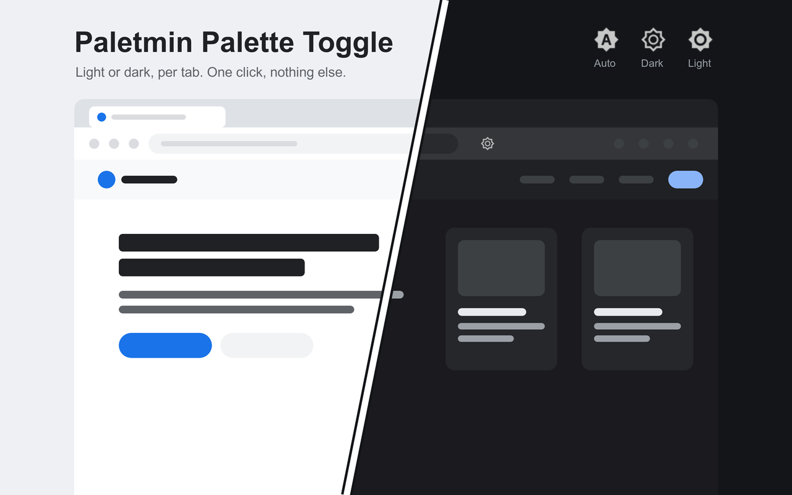

# Paletmin Palette Toggle



A Firefox extension that switches the current tab between a website's light and dark palettes. Requires Firefox 140 or later on desktop.

Click the toolbar icon to cycle through three modes:

- **Auto**: the tab follows Firefox's website appearance preference.
- **Dark**: the tab sees `prefers-color-scheme: dark`.
- **Light**: the tab sees `prefers-color-scheme: light`.

The first click selects the opposite of Firefox's page scheme. With light pages, the order is Auto → Dark → Light → Auto. With dark pages, it is Auto → Light → Dark → Auto. Each tab keeps its mode for the browser session. The icon shows the mode and adapts to Firefox's light or dark toolbar.

The extension changes the color scheme a website thinks you prefer. It does not add a theme of its own. If a website has no dark theme or ignores the system preference, nothing changes.

There is no popup, settings page, account, or data collection. See [PRIVACY.md](PRIVACY.md). The code is open source under the MIT license.

## Try it locally

1. Open `about:debugging#/runtime/this-firefox`.
2. Click **Load Temporary Add-on** and select this folder's `manifest.json`.
3. Reload any website tabs that were already open. Their slashed A icon says **Reload this page to enable palette switching** until you reload or navigate to a new page.
4. Click the toolbar icon on a website that supports light and dark themes.
5. Optional: open `about:addons`, click the gear, and choose **Manage Extension Shortcuts** to assign a shortcut.

Temporary add-ons are removed when Firefox quits. For a lasting installation in normal Firefox, use the signed version from Mozilla Add-ons.

Firefox asks for access to data on all websites. This lets the scripts run before each page's own scripts, including after navigation. The extension collects no data and makes no network requests. If you revoke its website access, it cannot change those pages.

## Package and submit

No compilation or dependencies are needed. From this folder, run:

```sh
python3 build.py
```

This creates `dist/paletmin-firefox-1.1.2.zip`, with `manifest.json` at the archive root. The filename follows the version in the manifest. Screenshots and development files are not included.

Upload the ZIP in the [Mozilla Add-on Developer Hub](https://addons.mozilla.org/developers/), choosing **On this site** for a public listing. Use [promo/store-listing.md](promo/store-listing.md) for the listing text and reviewer notes. Mozilla validates, signs, and reviews the extension; creating a ZIP does not publish it.

Publish this repository before using its GitHub support and privacy links in the listing. Keep the manifest's add-on ID, `paletmin@min.tools`, unchanged for future updates. Increase the version when uploading an update.

The manifest declares that no data is collected or transmitted. All scripts are readable source, with no bundling, minification, or remote code. See Mozilla's [submission guide](https://extensionworkshop.com/documentation/publish/submitting-an-add-on/) and [data declaration requirements](https://extensionworkshop.com/documentation/develop/firefox-builtin-data-consent/).

## How it works

When the selected scheme differs from Firefox's page scheme, the extension swaps `dark` and `light` in accessible `prefers-color-scheme` queries:

- `@media` and `@import` rules in stylesheets, including nested groups;
- `media` attributes on elements such as `<source>`, `<link>`, and `<style>`;
- `matchMedia()` results and their `change` events, through a script in the page's JavaScript world.

Rules inside cross-origin stylesheets cannot be read and remain unchanged. If a page declares both light and dark in `color-scheme` on its root or body, the extension forces that property too. This affects `light-dark()` colors and form controls.

The mode is applied to every accessible frame and reapplied after navigation. Auto restores the original queries. `content.js` relays modes and Firefox's native page scheme. `page.js` keeps the CSS originals and `matchMedia()` patch together in a persistent page-side controller. This lets a new script restore the page after an extension reload, even when Firefox has already discarded the old content script.

After installation, website tabs that were already open show a disabled, slashed A and ask you to reload. New pages work normally. Only a controller installed at document start can enable its tab; changing a URL fragment or reloading an iframe does not count. Protected pages show **Palette switching is unavailable on this page** instead.

After an update or re-enabling, the extension reconnects relays to existing document-start controllers. Other pages need a reload. A click calls the controller directly and saves the mode only after the top frame's controller finishes. Session storage preserves readiness and mode across background restarts.

The toolbar icons contain the same glyphs as the [Chrome version](https://github.com/min-tools/paletmin-chrome), wrapped in SVG media queries so Firefox chooses their light or dark variant independently of the page's appearance.

## Limits

- Firefox's internal pages, PDF viewer, and protected Mozilla sites do not allow content scripts. Their slashed A stays disabled, even after reloading.
- Styles inside shadow roots are not rewritten.
- Rules inside stylesheets loaded from another origin are not rewritten. A `media` attribute on their `<link>` element is still handled.
- Scripts that call `matchMedia()` before the saved mode arrives may see Firefox's page scheme. They receive a `change` event once the mode is applied.
- Tabs opened before installation require one full reload or navigation so the scripts can run before the site's own theme listeners. Paletmin never reloads pages automatically.
- Reloading or updating the extension can reset the per-tab modes to Auto. After disabling or removing it, reload affected pages to clear its page-side changes.
- This package targets desktop Firefox, not Firefox for Android.

## Author

[Ilia Ross](https://github.com/iliaross).
